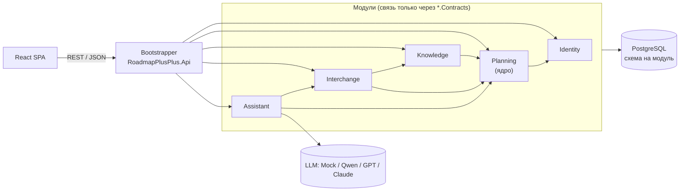

# Roadmap++

Сервис для роадмапов и планирования задач в команде. Это один таймлайн от года до минут: гранты, учёба, хакатоны, конференции. Внутри каждого события есть таблица задач, расписание и база знаний в Markdown, которую удобно отдать ИИ.

> **Стадия:** этап 0 — каркас. Пустое приложение собирается и тестируется в CI и поднимается одной командой `docker compose up`. Дальше — этап 1 (см. [План работ](#план-работ)).

| Где | Как пишем |
|---|---|
| В интерфейсе и текстах | **Roadmap++** |
| Репозиторий, Docker-образы, домен | `roadmap-plus-plus` |
| .NET (решение, проекты, пространства имён) | `RoadmapPlusPlus` |

Символ `+` нельзя использовать в именах C#, Docker-образов и пакетов, поэтому имён три.

---

## Содержание

- [Что умеет (цель)](#что-умеет-цель)
- [Главный принцип: всё — дерево](#главный-принцип-всё--дерево)
- [Архитектура: модульный монолит](#архитектура-модульный-монолит)
- [Доменная модель](#доменная-модель)
- [Стек](#стек)
- [Структура репозитория](#структура-репозитория)
- [Импорт и экспорт Markdown](#импорт-и-экспорт-markdown)
- [Открытый вопрос: Google Таблицы или своя таблица](#открытый-вопрос-google-таблицы-или-своя-таблица)
- [ИИ-ассистент](#ии-ассистент)
- [Принципы интерфейса](#принципы-интерфейса)
- [Запуск](#запуск)
- [Ветки и PR](#ветки-и-pr)
- [План работ](#план-работ)

---

## Что умеет (цель)

| Экран | Что там |
|---|---|
| **Роадмап** (главная) | Таймлайн по дням. Сверху макрособытия (грант на год, учёба, проектная деятельность), под ними события (хакатоны, конференции). Колёсиком мыши меняется масштаб от года до часов: при приближении блоки «раскрываются» в то, из чего состоят. Клик или ПКМ по событию открывает его панель. |
| **Событие** | Вкладки: **Задачи** (таблица: ID, ответственный, статус, «зависит от», свои колонки), **Расписание** (по часам: «17:00 — брейншторм в СКБ»), **База знаний** (MD: ТЗ, критерии, посты из TG), **Сводка** (прогресс по людям и дням — то, что раньше считали формулами). |
| **Сегодня / завтра** | Все мои задачи и слоты из всех событий вперемешку, по дням. |
| **База знаний** | MD-документы, привязанные к любому узлу. Кнопка «Скопировать контекст для ИИ». |
| **Импорт / экспорт** | Таблица задач события ⇄ `.md` прямо в сервисе. Импорт идёт через предпросмотр изменений. |
| **ИИ-ассистент** | Раскладывает текст организаторов на события, задачи и тайминги и показывает, что взято из текста, а что додумано. |

## Главный принцип: всё — дерево

> «Чем меньше исключений — тем понятнее». Любое одиночное событие — часть чего-то большего: лекция по ОП — часть «Учёбы», хакатон — часть «Проектной деятельности».

Поэтому в ядре **одна сущность — узел (`Item`)**. Макрособытие, событие, группа и задача — это его виды.

Что из этого следует:
- **Таймлайн** показывает узлы с датами, а глубина зависит от масштаба: год → макро, месяц → события, день → группы и задачи, часы → слоты.
- **Таблица задач** события — это его потомки-задачи, сгруппированные по родителям («День 1 → Организация и репозиторий»).
- **Импорт/экспорт, ИИ, права и история** пишутся один раз, для узла, а не отдельно для каждого вида.

## Архитектура: модульный монолит

Систему режем **вертикально — по бизнес-модулям**, а слои (`Domain` / `Application` / `Infrastructure` / `Endpoints`) остаются папками внутри модуля. Всё собирается в одно приложение и разворачивается одним контейнером. Почему не слоистый монолит и не микросервисы, разобрано в [ADR-0002](docs/decisions/0002-modular-monolith.md).

| Модуль | Отвечает за |
|---|---|
| **Identity** | пользователи, команды, участники, роли, приглашения, вход |
| **Planning** — ядро | дерево `Item`, свои поля и статусы, зависимости, ссылки, расписание, **ChangeSet**, история; «Сегодня / завтра» и «Сводка» |
| **Knowledge** | MD-документы у узлов, вложения, полнотекстовый поиск |
| **Interchange** | каноническая `TaskTable` и адаптеры: Markdown, xlsx/csv, Google Таблицы (ADR-0001), «контекст для ИИ», позже iCal |
| **Assistant** | провайдеры LLM, промпты, сессии, учёт токенов |
| **Notifications** *(позже)* | Telegram-бот: «задачи на завтра», дедлайны, назначения |



Стрелки — зависимости через контракты. Identity нужен всем модулям, но на схеме показана только его связь с ядром, чтобы не загромождать её.

Правила границ (подробно в ADR-0002):
1. Модуль видит у других модулей **только** `*.Contracts`. Остальное объявлено `internal`, поэтому нарушение не скомпилируется. В CI правила дополнительно проверяют архитектурные тесты.
2. **Писать в дерево может только Planning.** Импорт и ИИ лишь *предлагают* `ChangeSet` — список правок с пометками «из источника / додумано». Человек смотрит его и применяет всё или часть. Один механизм и один экран просмотра служат и для MD-импорта, и для будущего Google, и для ассистента.
3. Одна база, **своя схема на модуль**, свой `DbContext` и свои миграции. Между схемами нет JOIN: ссылки только по Id.
4. Реакции на события («узел удалён → архивировать документы») идут через простую внутрипроцессную шину из `BuildingBlocks`.

## Доменная модель

Черновик, уточняем на этапе 1.

| Сущность | Модуль | Что это | Ключевые поля |
|---|---|---|---|
| `Workspace`, `Member` | Identity | команда и её участники | название; пользователь, роль (`owner` / `editor` / `viewer`), цвет |
| `Item` | Planning | узел дерева | `parentId`, `kind` (`macro` / `event` / `group` / `task`), `title`, `code` (`D1-01`), `start` / `end` / `allDay`, `status`, `assignees[]`, `fields` (JSONB со значениями своих колонок), `position`, `descriptionMd`, `taskSource` (у события) |
| `FieldDefinition` | Planning | своя колонка таблицы, как выпадающий список с проверкой данных в Google Таблицах | владелец (событие или шаблон), `key`, `title`, `type` (`text` / `select` / `multiselect` / `date` / `url`), `options[]` |
| `StatusDefinition` | Planning | набор статусов команды | название, цвет, `isDone` (по умолчанию: НЕ ГОТОВО, В ПРОЦЕССЕ, ОЖИДАЮ ЗАВИСИМОСТЬ, ГОТОВО) |
| `Dependency` | Planning | «Зависит от» | `itemId`, `dependsOnId` |
| `Link` | Planning | внешняя ссылка у узла | `url`, `kind` (`google_sheet` / `tg_post` / `repo` / `figma` / …), `title` |
| `ChangeSet` | Planning | пакет предложенных правок; применяется после просмотра | источник (`import_md` / `import_xlsx` / `assistant`), статус, правки: операция, цель, было / стало, **происхождение** (`from_input` / `inferred`), причина |
| `Activity` | Planning | история изменений | кто, когда, что |
| `KnowledgeDoc` | Knowledge | MD-документ у узла | `itemId`, `title`, `contentMd`, `sourceUrl`, теги |
| `AssistantSession` | Assistant | диалог с ассистентом | провайдер, модель, токены, итоговый `changeSetId` |

Дерево хранится в PostgreSQL как список смежности (`parent_id`) и читается рекурсивными CTE. Если упрёмся в скорость, подключим расширение `ltree`.

## Стек

Библиотеки — кандидаты, финально выбираем при создании проектов.

| Слой | Технология | Зачем |
|---|---|---|
| Backend | .NET 10 (LTS), ASP.NET Core, OpenAPI | основной сервер |
| Доступ к данным | EF Core + Npgsql | `DbContext` на модуль, JSONB для своих колонок |
| БД | PostgreSQL 17+ | дерево, JSONB, полнотекстовый поиск по базе знаний |
| Markdown на сервере | Markdig (GFM-таблицы, YAML front matter), YamlDotNet | импорт/экспорт |
| ИИ | Microsoft.Extensions.AI (`IChatClient`) | один интерфейс для Mock / OpenAI-совместимых (Qwen, GPT) / Claude |
| Границы модулей | xUnit-тесты: граф ссылок из `.csproj`, публичные типы модулей через reflection. ArchUnitNET — когда понадобятся правила слоёв внутри модуля | архитектурные тесты в CI |
| Realtime (позже) | SignalR | совместное редактирование |
| Frontend | React 19, TypeScript 6, Vite 8, линтер oxlint | SPA |
| Данные на фронте | TanStack Query, клиент из OpenAPI (orval / openapi-typescript) | кэш, типы из контракта |
| Таблица задач | TanStack Table | своя таблица (вариант A из ADR-0001) |
| Таймлайн | d3-scale + d3-zoom, своя отрисовка (SVG / Canvas) | плавный зум год → минуты; для быстрого прототипа — vis-timeline |
| Markdown на фронте | react-markdown + remark-gfm; редактор — CodeMirror 6 или Milkdown | просмотр и правка базы знаний |
| Инфраструктура | Docker Compose, Nginx | один `docker compose up`, статика + прокси `/api` |
| Тесты | xUnit v3 на Microsoft.Testing.Platform, Testcontainers (Postgres), Vitest, Playwright | |
| CI | GitHub Actions | сборка и тесты на каждый PR |

Для хостинга хватит слабого VPS: API, Postgres и Nginx укладываются примерно в 1–2 ГБ ОЗУ. Модели на этом сервере не запускаем: ИИ работает через внешний API или через Ollama на чьём-то ПК.

## Структура репозитория

```
roadmap-plus-plus/
├── README.md
├── .editorconfig, .gitattributes, .gitignore
├── compose.yaml                             # стенд: db + api + nginx
├── compose.override.yaml                    # локально: Development, порт БД наружу
├── .env.example                             # переменные для compose; копируется в .env
├── .github/workflows/                       # CI: backend.yml — формат, сборка, тесты; frontend.yml — линтер, сборка
│
├── backend/
│   ├── Dockerfile                           # образ API: сборка на SDK, запуск на aspnet
│   ├── RoadmapPlusPlus.slnx                 # решение (.NET 10 создаёт .slnx вместо .sln)
│   ├── global.json                          # SDK 10.0.x; dotnet test в режиме Microsoft.Testing.Platform
│   ├── Directory.Build.props                # общие настройки: net10.0, nullable, предупреждения = ошибки
│   ├── Directory.Packages.props             # версии всех NuGet-пакетов в одном месте
│   ├── src/
│   │   ├── Bootstrapper/
│   │   │   └── RoadmapPlusPlus.Api/         # Program.cs: подключает модули, auth, OpenAPI, health
│   │   │       └── Middleware/              # ошибки, логирование, id запроса
│   │   ├── BuildingBlocks/
│   │   │   └── RoadmapPlusPlus.BuildingBlocks/   # Result, Entity, IModule, шина событий — минимум общего
│   │   └── Modules/
│   │       ├── Identity/
│   │       │   ├── RoadmapPlusPlus.Modules.Identity/            # Domain, Application, Infrastructure, Endpoints
│   │       │   └── RoadmapPlusPlus.Modules.Identity.Contracts/  # текущий пользователь, проверка прав
│   │       ├── Planning/                                         # ЯДРО
│   │       │   ├── RoadmapPlusPlus.Modules.Planning/
│   │       │   │   ├── Domain/                                   # Items, Fields, ChangeSets
│   │       │   │   ├── Application/                              # Items, ChangeSets, Agenda, Summary
│   │       │   │   ├── Infrastructure/Persistence/               # PlanningDbContext (схема planning), миграции
│   │       │   │   └── Endpoints/
│   │       │   └── RoadmapPlusPlus.Modules.Planning.Contracts/  # чтение дерева, Propose/ApplyChangeSet, события
│   │       ├── Knowledge/
│   │       │   ├── RoadmapPlusPlus.Modules.Knowledge/           # MD-документы, вложения, поиск
│   │       │   └── RoadmapPlusPlus.Modules.Knowledge.Contracts/
│   │       ├── Interchange/
│   │       │   ├── RoadmapPlusPlus.Modules.Interchange/
│   │       │   │   ├── Application/                              # TaskTable, ITaskTableImporter/Exporter
│   │       │   │   ├── Adapters/
│   │       │   │   │   ├── Markdown/                             # task-table@0 — делаем в любом случае
│   │       │   │   │   ├── AiContext/                            # база знаний + задачи одним файлом
│   │       │   │   │   ├── Xlsx/                                 # вариант D из ADR-0001
│   │       │   │   │   └── GoogleSheets/                         # вариант C из ADR-0001 — пусто
│   │       │   │   └── Endpoints/
│   │       │   └── RoadmapPlusPlus.Modules.Interchange.Contracts/
│   │       ├── Assistant/
│   │       │   └── RoadmapPlusPlus.Modules.Assistant/           # без Contracts: его никто не вызывает
│   │       │       ├── Application/                              # сценарии: текст → ChangeSet, «по часам»
│   │       │       ├── Providers/                                # Mock, OpenAI-совместимый, Anthropic
│   │       │       ├── Prompts/                                  # промпты в .md
│   │       │       ├── Infrastructure/                           # сессии, учёт токенов
│   │       │       └── Endpoints/
│   │       └── Notifications/                                    # позже: Telegram-бот
│   └── tests/
│       ├── RoadmapPlusPlus.ArchitectureTests/       # границы модулей: только *.Contracts, без циклов
│       ├── RoadmapPlusPlus.Modules.Planning.Tests/
│       ├── RoadmapPlusPlus.Modules.Knowledge.Tests/
│       ├── RoadmapPlusPlus.Modules.Interchange.Tests/
│       │   └── Fixtures/                            # bpmn-hackathon-roadmap.md — реальная таблица в MD
│       ├── RoadmapPlusPlus.Modules.Assistant.Tests/
│       └── RoadmapPlusPlus.IntegrationTests/        # API + Postgres в Testcontainers
│
├── frontend/                                # Feature-Sliced Design (облегчённый)
│   ├── Dockerfile                           # образ nginx со сборкой фронта
│   ├── public/
│   └── src/
│       ├── app/                             # вход (main.tsx, App.tsx), роутер, провайдеры, глобальные стили
│       ├── pages/                           # roadmap, event, agenda, knowledge, settings
│       ├── widgets/                         # timeline, event-panel, task-table, agenda-list,
│       │                                    # kb-viewer, assistant-panel
│       ├── features/                        # timeline-zoom, item-edit, task-status,
│       │                                    # md-export, md-import, changeset-review
│       ├── entities/                        # item, member, field, kb-doc
│       └── shared/                          # api (клиент из OpenAPI), ui-kit, lib, config
│
├── deploy/
│   ├── nginx/default.conf                   # статика фронта + прокси /api на api:8080
│   ├── postgres/init/                       # схемы модулей; выполняется при первом запуске БД
│   └── scripts/                             # деплой, бэкап БД
│
└── docs/
    ├── decisions/                           # ADR — архитектурные решения
    │   ├── 0001-task-table-source.md        # ОТКРЫТ: Google Таблицы или своя таблица
    │   └── 0002-modular-monolith.md         # принят: модульный монолит
    ├── formats/
    │   ├── task-table-md.md                 # черновик формата MD для задач
    │   └── examples/                        # наша таблица BPMN-хакатона в MD
    └── design/                              # макеты, скриншоты, референсы интерфейса
```

## Импорт и экспорт Markdown

- **Экспорт:** событие выгружается в `.md` с YAML-шапкой (колонки, списки значений, статусы) и таблицами по группам. Файл открывается в GitHub и Obsidian и сразу годится как контекст для ИИ.
- **Импорт:** `.md` превращается в предпросмотр (`ChangeSet`). Задачи сопоставляются по `ID`, новые создаются, отсутствующие по умолчанию не удаляются, а правки поверх свежих изменений в сервисе помечаются как конфликты.
- Формат описан в [`docs/formats/task-table-md.md`](docs/formats/task-table-md.md). Пример — наша таблица BPMN-хакатона: [`docs/formats/examples/bpmn-hackathon-roadmap.md`](docs/formats/examples/bpmn-hackathon-roadmap.md).

## Открытый вопрос: Google Таблицы или своя таблица

Есть два взгляда:
- **своя таблица в сервисе** с импортом/экспортом MD: задачи видны таймлайну, «Сегодня» и ИИ;
- **Google Таблица по ссылке**: готовая привычная среда, почти без разработки.

Решаем после этапа 1, на прототипе и реальном событии. Вопрос целиком живёт в модуле Interchange, ядро от него не зависит. Ссылки у узлов есть с первого дня, так что Google Таблицу можно прикрепить к событию сразу. Форматы обмена — сменные адаптеры вокруг одной модели `TaskTable`, а у события есть переключатель `taskSource`. Варианты, сравнение и критерии — в [ADR-0001](docs/decisions/0001-task-table-source.md).

## ИИ-ассистент

- **Провайдеры за одним интерфейсом:** `Mock` (детерминированный, для разработки и тестов), затем OpenAI-совместимый endpoint (Qwen через Ollama / vLLM, GPT), затем по желанию Anthropic со своим ключом. Смена провайдера — это настройка, а не код.
- **Сценарии v1:** «вставил текст организаторов → события, задачи, тайминги» и «распиши событие по часам».
- **Позже:** риски, дедлайны, «что сделать в ближайшие дни» — на более сильной модели.
- **Ответ — не текст, а `ChangeSet`:** структурированный JSON по схеме проходит проверку и превращается в список правок с пометками *из текста* / *додумано* и причиной. Человек принимает правки по одной или пачкой.
- **Контекст** собирает адаптер `AiContext` из Interchange: ИИ видит ровно то, что вы бы скопировали кнопкой «контекст для ИИ».

## Принципы интерфейса

- Один экран — один вопрос: «что у нас в этом году?», «что в этом событии?», «что мне делать завтра?».
- Детали раскрываются по клику или зуму, а не все сразу, чтобы не было перегруза.
- Зум колёсиком нужен для обзора, клик и ПКМ по блоку — для работы. Оба пути ведут в одну панель.
- Добавить задачу или слот можно не больше чем за два действия от таймлайна.
- Референсы: Linear (проекты и роадмап), GitHub Projects (вид Roadmap), Notion (Timeline + базы со своими полями), Obsidian (MD-база знаний). Скриншоты и макеты лежат в `docs/design/`.

## Запуск

Нужен Docker с Compose v2.

```bash
cp .env.example .env
docker compose up -d --build
# UI:      http://localhost:8080
# API:     http://localhost:8080/api
# OpenAPI: http://localhost:8080/api/openapi/v1.json
```

`docker compose` сам подхватывает `compose.override.yaml` с настройками для локальной работы: API в режиме Development, БД открыта на хосте как `127.0.0.1:5433`. Порт меняется через `DB_PORT` в `.env`; 5432 не берём, потому что его часто занимает локальный PostgreSQL. На сервере override не нужен: `docker compose -f compose.yaml up -d --build`, а в `.env` задаётся свой пароль БД.

Схемы модулей из `deploy/postgres/init/` создаются только при первом запуске, на пустом томе `db-data`. Сбросить базу: `docker compose down -v`.

Локальная разработка: `docker compose up -d db`, затем `dotnet watch` в `backend/src/Bootstrapper/RoadmapPlusPlus.Api` и `npm ci && npm run dev` в `frontend/` (Node 24 из `frontend/.nvmrc`; Vite на `:5173` проксирует `/api` на бэкенд `:5080`).

<details>
<summary>Как превратить папки в проекты (этап 0)</summary>

```bash
cd backend
P=RoadmapPlusPlus
dotnet new sln -n $P

dotnet new webapi   -o src/Bootstrapper/$P.Api
dotnet new classlib -o src/BuildingBlocks/$P.BuildingBlocks

# модули: реализация → BuildingBlocks; Api подключает каждый модуль
for m in Identity Planning Knowledge Interchange Assistant; do
  dotnet new classlib -o src/Modules/$m/$P.Modules.$m
  dotnet add src/Modules/$m/$P.Modules.$m reference src/BuildingBlocks/$P.BuildingBlocks
  dotnet add src/Bootstrapper/$P.Api reference src/Modules/$m/$P.Modules.$m
done

# контракты — только у тех, кого вызывают другие модули
for m in Identity Planning Knowledge Interchange; do
  dotnet new classlib -o src/Modules/$m/$P.Modules.$m.Contracts
  dotnet add src/Modules/$m/$P.Modules.$m.Contracts reference src/BuildingBlocks/$P.BuildingBlocks
  dotnet add src/Modules/$m/$P.Modules.$m reference src/Modules/$m/$P.Modules.$m.Contracts
done

# связи между модулями — только через Contracts (граф из ADR-0002)
c() { echo src/Modules/$1/$P.Modules.$1.Contracts; }
dotnet add src/Modules/Planning/$P.Modules.Planning       reference $(c Identity)
dotnet add src/Modules/Knowledge/$P.Modules.Knowledge     reference $(c Identity) $(c Planning)
dotnet add src/Modules/Interchange/$P.Modules.Interchange reference $(c Identity) $(c Planning) $(c Knowledge)
dotnet add src/Modules/Assistant/$P.Modules.Assistant     reference $(c Identity) $(c Planning) $(c Interchange)

dotnet sln add src/*/*/*.csproj src/Modules/*/*/*.csproj
```

Фронтенд создан шаблоном `create-vite` (`react-ts`) во временной папке и перенесён в FSD-структуру: точка входа — `src/app/main.tsx`, алиас `@/` указывает на `src/`.

Тестовые проекты создаём по мере появления тестов, по образцу `RoadmapPlusPlus.ArchitectureTests` (xUnit v3 на Microsoft.Testing.Platform). Шаблон `dotnet new xunit` не подходит: он создаёт проект на xUnit v2 и VSTest. Модуль Notifications создаём, когда до него дойдём.

</details>

## Ветки и PR

`main` всегда собирается и проходит CI. Напрямую в `main` не коммитим: любая работа идёт в короткой ветке и вливается через PR. Защита `main`: обязательный PR и зелёные проверки `backend` из [`.github/workflows/backend.yml`](.github/workflows/backend.yml) (формат кода, сборка, тесты) и `frontend` из [`.github/workflows/frontend.yml`](.github/workflows/frontend.yml) (линтер, проверка типов, сборка). Предупреждения в обоих считаются ошибками.

**Имя ветки:** `<тип>/<область>-<суть>`, а если есть issue — `<тип>/<номер>-<область>-<суть>`.

```
chore/backend-skeleton
test/arch-module-boundaries
feat/planning-item-tree
feat/23-frontend-timeline-zoom
fix/interchange-md-escaped-pipes
spike/frontend-timeline-d3-vs-vis
docs/adr-0001-task-table-source
```

| Тип | Когда |
|---|---|
| `feat` | новая возможность |
| `fix` | исправление ошибки |
| `refactor` | переделка без изменения поведения |
| `test` | только тесты |
| `docs` | README, ADR, описания форматов |
| `ci` | GitHub Actions |
| `chore` | каркас, зависимости, настройки, Docker и прочая инфраструктура |
| `spike` | прототип или эксперимент. Обычно не вливается: итог — вывод в ADR или issue, а код потом пишется начисто |

| Область | Что затрагивает |
|---|---|
| `identity`, `planning`, `knowledge`, `interchange`, `assistant`, `notifications` | модуль вместе с его `Contracts` и тестами |
| `api` | Bootstrapper: `Program.cs`, middleware |
| `blocks` | `BuildingBlocks` |
| `arch` | архитектурные тесты и правила границ модулей |
| `backend`, `frontend` | бэкенд или фронтенд целиком: решение, сборка, общие настройки, UI-кит |
| `deploy` | compose, Dockerfile, Nginx, скрипты |
| `adr-NNNN`, `formats`, `readme` | документация |

Правила:
- Только латиница в нижнем регистре, цифры и дефисы. Без кириллицы, пробелов и `_`.
- Суть — 2–4 английских слова о том, *что* делаем: `planning-item-tree`, а не `yaroslav-work` или `fix-2`.
- Фича, которая задевает и API, и экран, живёт в одной ветке с областью-модулем: `feat/planning-item-crud`. Область `frontend` — для того, что не привязано к модулю (таймлайн, UI-кит, роутер).
- Одна ветка — одна задача — один PR. Ветка живёт дни, а не недели. Создаём от свежего `main`, после слияния удаляем.
- Вливаем через **Squash and merge**: один PR — один коммит в `main`. Заголовок PR становится сообщением коммита и повторяет тип и область из имени ветки, текст — по-русски: `feat(planning): дерево узлов и CRUD`. Если есть issue, в описании PR пишем `Closes #23`.

## План работ

| Этап | Что делаем | Готово, когда |
|---|---|---|
| **0. Каркас** | Решение .NET с модулями, `BuildingBlocks`, архитектурные тесты, Vite-проект, `compose.yaml` (api + db + nginx), CI, health-check | `docker compose up` поднимает пустое приложение, CI зелёный |
| **1. Дерево и таймлайн** | Identity (вход, команда), Planning: CRUD узлов, вложенность, ссылки; таймлайн с зумом год → день, панель события по клику / ПКМ | заводим реальные макрособытия и события команды |
| **2. Таблица задач + MD** | Planning: свои колонки, статусы, ответственные, зависимости, сводка, ChangeSet. Interchange: адаптер Markdown | наша таблица BPMN-хакатона загружается из `.md` и выгружается обратно без потерь |
| **3. База знаний и «Сегодня»** | Knowledge, адаптер `AiContext`, вкладка «Сегодня / завтра», расписание по часам (зум до минут) | ведём ближайший хакатон в сервисе |
| **4. ИИ-ассистент** | Assistant: Mock → Qwen (OpenAI-совместимый) → свой ключ; текст → ChangeSet с пометками «из текста / додумано» | ассистент раскладывает положение о хакатоне в задачи |
| **5. Решение по ADR-0001** | Своя таблица / Google Таблицы / гибрид — по итогам этапов 2–3 | ADR-0001 в статусе «принят» |

Идеи на потом: Notifications (Telegram-бот «задачи на завтра»), совместное редактирование (SignalR), шаблоны событий («хакатон на 4 дня»), импорт старых таблиц из `.xlsx`/`.csv`, iCal-подписка на календарь.